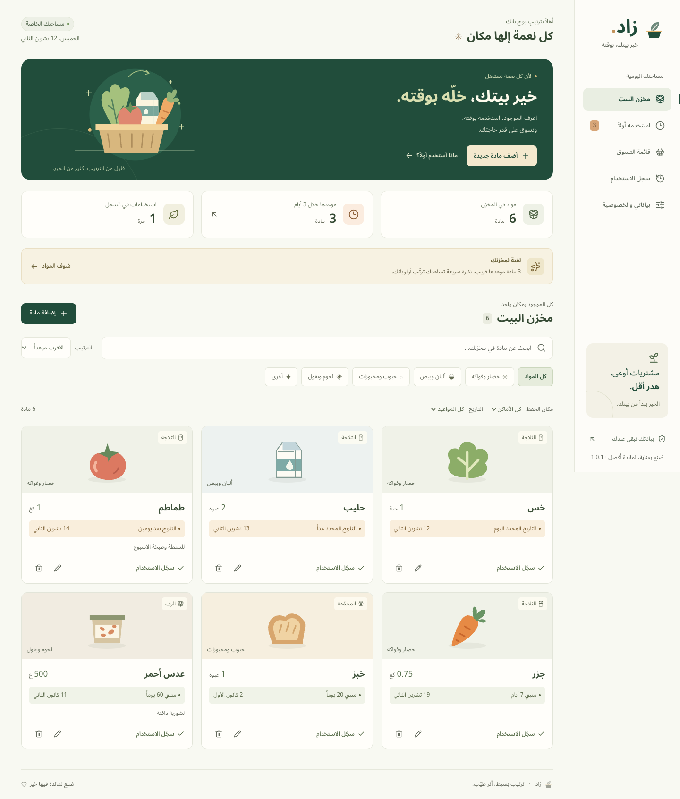
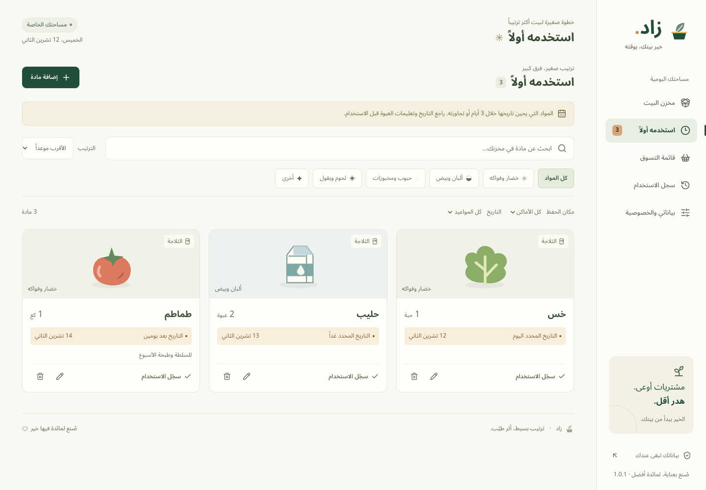
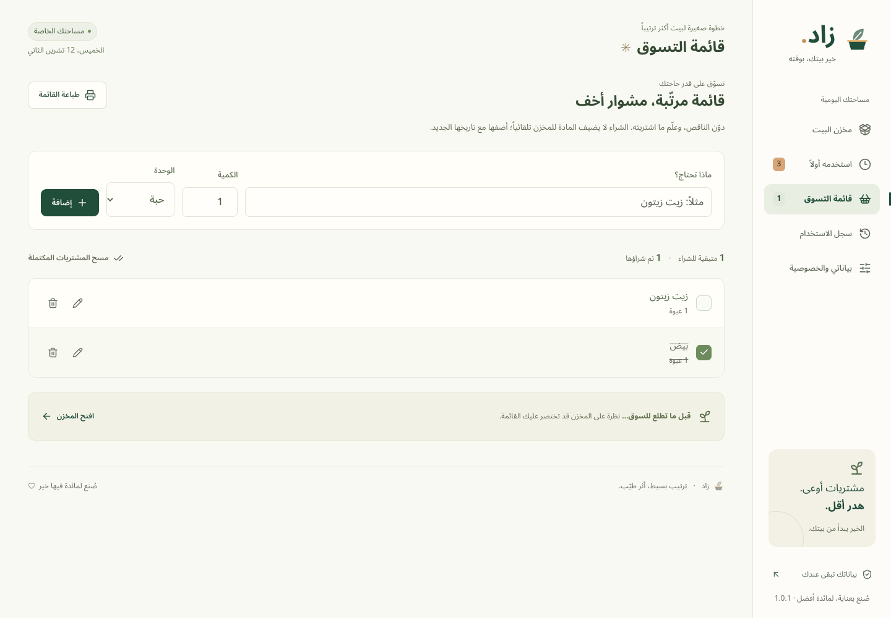
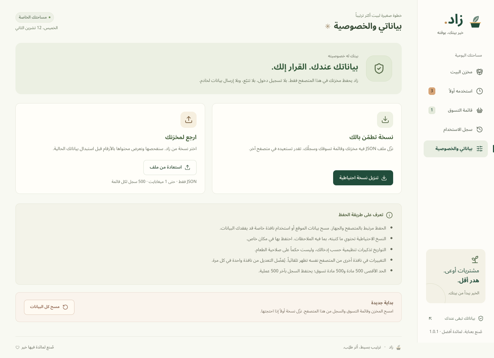
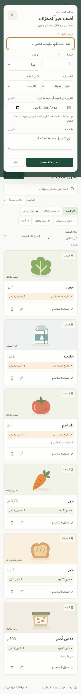

# زاد · Zaad

**A calmer kitchen starts with knowing what you have.**

Zaad is an Arabic, right-to-left pantry companion for households and shared kitchens. Keep track of ingredients, prioritize upcoming label dates, record what you use, and shop for what you actually need. Everything stays in your browser.



> **بالعربي:** زاد يساعدك ترتّب مؤن البيت، تراجع المواعيد القريبة، تسجّل الاستخدام، وتكتب قائمة تسوق واضحة. بلا حساب وبلا خادم؛ بياناتك في متصفحك، وتقدر تنقلها بنسخة احتياطية.

## Why this exists

Ingredients get forgotten behind other groceries, and duplicate purchases make a simple shopping trip harder. Zaad brings inventory and the next shopping list into one small, private workspace. Household food waste is a documented problem in the [UNEP Food Waste Index Report 2024](https://www.unep.org/resources/publication/food-waste-index-report-2024). Zaad's impact has not been measured; it offers practical tools to support better habits.

## What works

- **Pantry management:** add, edit and delete ingredients; fractional quantities, seven units, five categories, three storage locations, notes and optional dates.
- **Find what you have:** Arabic-aware search (including diacritics and alef variants), category/location/date filters, urgency/name/newest sorting and useful empty states.
- **Use first:** an automatically derived queue for dates within three days and dates already passed. Record partial or complete use or disposal, with a real activity history. Depleted items can be added to shopping with one unit.
- **Shopping checklist:** add, edit, remove, check/uncheck, merge matching active entries with the same unit, clear completed purchases with confirmation, and print a clean list.
- **Your data, your choice:** local persistence; JSON export; size-limited, schema-validated import with a preview and explicit replacement; protected corrupt-data recovery; visible storage errors; same-browser tab updates.

First launch is empty. Fictional sample ingredients appear only after choosing **جرّب مخزناً توضيحياً**. Every displayed count is derived from the current records. There are no accounts, invented savings metrics, paid services or placeholder controls.

## Design

Version **1.0.1** refines the existing experience with larger text and inputs, more comfortable mobile targets, long-text reflow and a compact populated-pantry introduction. The feature scope and backup format remain unchanged.

An original forest-green and warm-ivory visual system, self-hosted **Noto Sans Arabic**, restrained citrus accents, custom SVG food illustrations and Lucide icons. The layout adapts from a right-hand desktop navigation rail and three-column pantry to compact mobile navigation and single-column cards.

Keyboard support includes a skip link, labelled controls, visible focus, modal focus containment, Escape-to-close and return focus. Statuses use text as well as color, and transitions respect reduced-motion preferences. Automated accessibility and responsive checks are documented in [QA results](docs/QA.md); they do not replace a full assistive-technology audit.

<details>
<summary>More real application screenshots</summary>






All screenshots are browser captures of this application with fictional test data. The mobile pantry is available in [mobile-pantry.png](docs/screenshots/mobile-pantry.png).

</details>

## Run locally

Use **Node.js 22.12+** (Node 24 LTS is recommended) and npm.

```bash
npm ci
npm run dev
```

Open the local address printed by Vite (normally `http://127.0.0.1:5173`). No `.env`, API keys, database or backend setup is required.

```bash
# Inspect an optimized production build locally
npm run build
npm run preview
```

For consistent browser data, use the same scheme, host and port each time; `localhost` and `127.0.0.1` are different storage origins.

## Check and test

```bash
npm run lint
npm run typecheck
npm run format:check
npm test
npm run build

# One-time browser installation
npx playwright install chromium

# Builds production assets and tests desktop + mobile Chromium
npm run test:e2e

# Optional: interactive unit tests or inspect browser failures
npm run test:watch
npx playwright show-report
```

Vitest covers date arithmetic, input boundaries, reducers, Arabic search, backup validation and persistence failures. Playwright exercises the three main end-to-end journeys plus security, recovery, keyboard, RTL, responsive, print and accessibility checks. It captures real screenshots in `docs/screenshots/`. Test data is synthetic and each browser test starts in an isolated context.

CI uses the lockfile and Node 24, runs lint, type checks, formatting, unit tests, a production build and both browser projects. It uploads the test report and screenshots. It does **not** deploy the site. See [the workflow](.github/workflows/ci.yml) and [verified QA results](docs/QA.md).

## Architecture

| Layer      | Choice                                         | Reason                                                           |
| ---------- | ---------------------------------------------- | ---------------------------------------------------------------- |
| UI         | React + TypeScript                             | Typed state and reusable accessible components                   |
| Build      | Vite                                           | Small static application, simple development and deployment      |
| Validation | Zod                                            | One schema for forms, stored data and portable backups           |
| Storage    | Browser localStorage                           | No service costs, account requirements or server data collection |
| Visuals    | CSS, custom SVG, Lucide, Fontsource            | Local assets with no runtime third-party requests                |
| Quality    | ESLint, Prettier, Vitest, Playwright, axe-core | Repeatable source and user-journey checks                        |

```text
src/
  App.tsx               # Navigation, UI orchestration and persistence feedback
  components/           # Pantry, editors, dialogs, notices, original art, error boundary
  pages/                # Shopping, activity and data/privacy screens
  lib/model.ts          # Validated domain model, date/search helpers and immutable actions
  lib/storage.ts        # Persistence, recovery and export
  lib/*.test.ts         # Domain and storage tests
  styles.css            # Responsive component styles and print/reduced-motion support
  tokens.css            # Brand tokens
e2e/                    # Browser acceptance and accessibility tests
docs/                   # Product decisions, QA record and actual screenshots
```

Calendar arithmetic compares local civil dates using UTC day boundaries, avoiding DST-hour differences. Display dates follow the device's local calendar day. Quantities accept up to three decimal places; subtraction is rounded at that precision. Current stock is removed only after complete use/disposal; the history remains. The history keeps the latest 500 events.

The development dependency `minimatch` is overridden to `11.0.8` to address the audit advisory affecting versions below 11.0.1. The override is covered by successful lint, type and build checks; review it when updating ESLint/typescript-eslint.

## Privacy and limits

- Records are **local to one browser and origin**, not synchronized between devices. Clearing site data or using private browsing may discard them. Export backups regularly.
- Storage is not encrypted. Anyone with access to the same browser profile can access its records. JSON backups include ingredient notes; store them privately.
- A corrupt stored document is not silently replaced. Normal editing is blocked until the user restores a valid backup or explicitly resets it. Storage-write errors retain edits in memory and clearly ask for a backup.
- Imports are capped at **1 MB**; the pantry, shopping list and history each hold at most **500 records**. Unknown versions, extra fields, invalid quantities/dates and duplicate IDs are rejected. Import replaces all records after an explicit preview confirmation.
- Same-origin tabs receive storage updates, but simultaneous editing uses last-write-wins. Use one editing tab at a time.
- Dates are organizational reminders based on the user's input. They are **not food-safety advice**. Follow product labels and appropriate handling instructions.
- There are no push notifications, barcode scans, recipes, cloud accounts or an installable offline service worker. After loading, interactions use local data; first load and reload still need the static app to be served.

See [SECURITY.md](SECURITY.md) for the security model and reporting guidance.

## Hosting

Zaad builds to `dist/` and can run on any static host. HTTPS is recommended. If publishing under a subdirectory, set Vite's `base` and update the favicon path accordingly. Configure security headers at your host; the included HTML Content Security Policy restricts resources to the same origin, with the local WebSocket exception needed for Vite development. Prefer a production HTTP CSP header without that development WebSocket exception and without `unsafe-inline` for styles if your host supports it. Set `frame-ancestors 'none'` as an HTTP header to prevent embedding.

No external hosting is provisioned by this repository. GitHub source publication and website deployment are separate actions.

## Contributing

See [CONTRIBUTING.md](CONTRIBUTING.md). Keep the server-free baseline, proper RTL, local assets and truthful product behavior. Include tests for changes to quantities, dates, imports or persistence.

## Next steps

1. Installable PWA with verified offline updates and user-controlled reminder support.
2. Optional, encrypted household synchronization with explicit sharing controls.
3. Barcode-assisted entry with local correction and a clearly documented data source.

Released under the [MIT license](LICENSE). Font and icon licenses are recorded in [THIRD_PARTY_NOTICES.md](THIRD_PARTY_NOTICES.md).
